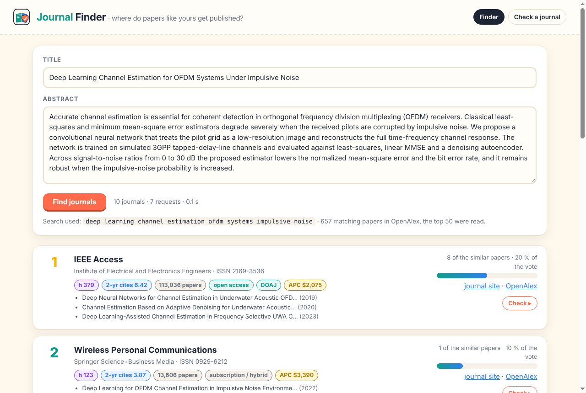
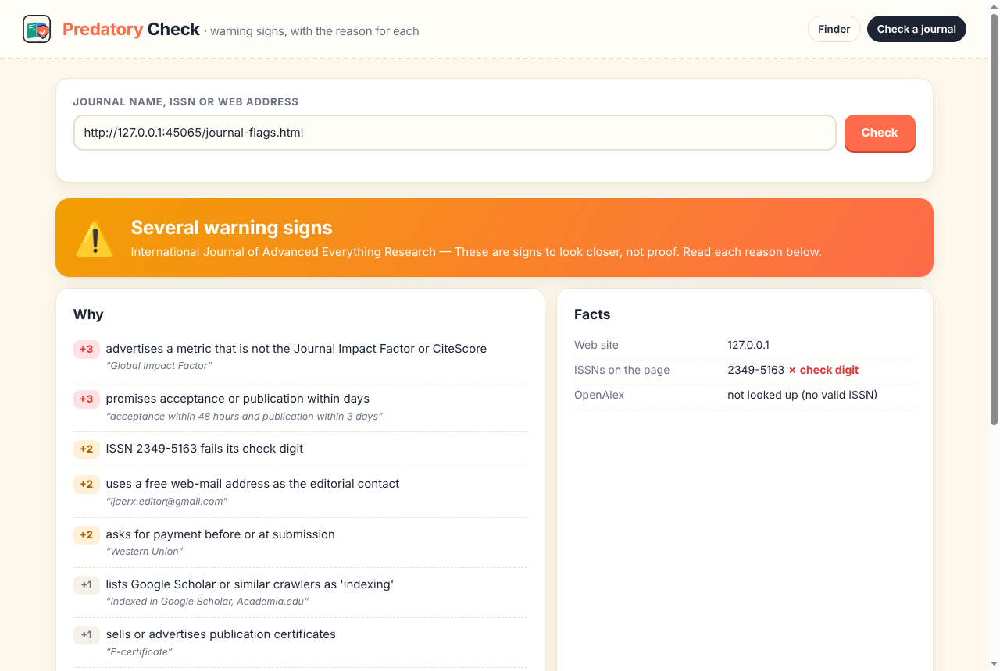
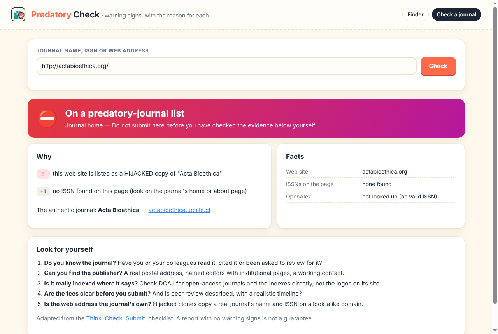
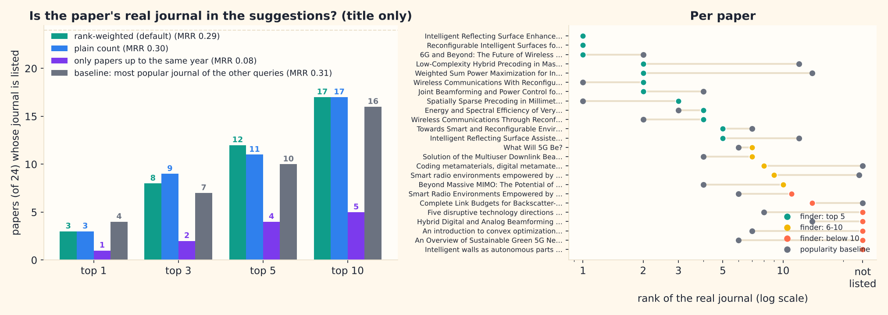
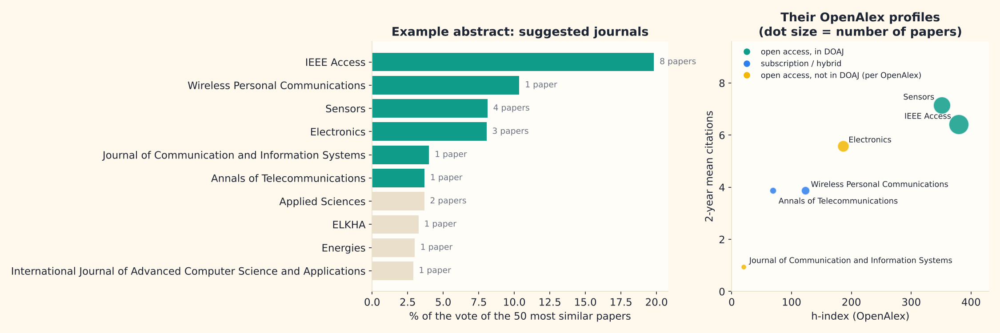
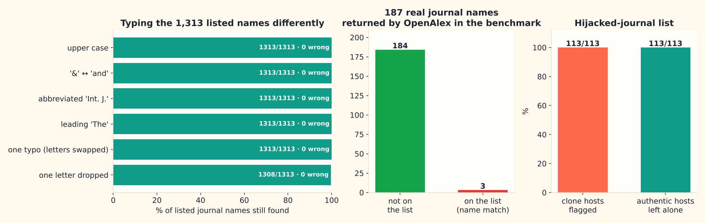
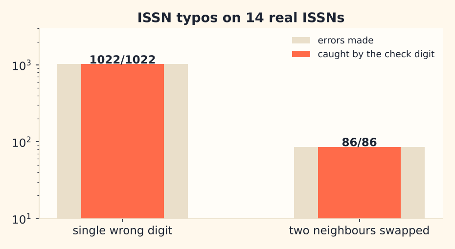

<p align="center">
  
</p>

<p align="center">
  
  
  
  
  
  
</p>

# Journal Finder & Predatory Check

Two tools that researchers need at the same moment, just before they submit:

* **🔭 Journal Finder.** Paste your title and abstract. The 50 most similar papers in
  [OpenAlex](https://openalex.org) vote for the journal they were published in, and every
  suggestion comes with its OpenAlex profile: h-index, 2-year mean citations, size, open access,
  DOAJ and APC. Each suggestion is also checked against the predatory lists.
* **🛡️ Predatory Check.** Open a journal's web site and click the extension. It looks for:
  * the journal, its publisher or its web host on the bundled
    [Stop Predatory Journals](https://github.com/stop-predatory-journals/stop-predatory-journals.github.io)
    lists;
  * **hijacked clones**, which are look-alike sites of real journals;
  * ISSNs that fail their check digit;
  * the warning signs those sites print on their own pages: fake impact factors,
    "published in 48 hours", gmail editors, "indexed in Google Scholar" and so on.

  Every finding shows **the reason and the text that triggered it**. The checker never says
  "safe": at best it says "no warning signs found".

There is no server, no account and no API key. Nothing leaves your browser except the OpenAlex
queries.

<p align="center"></p>

---

## Contents

1. [What it looks like](#what-it-looks-like)
2. [Install](#install)
3. [How the finder works](#how-the-finder-works)
4. [How the check works](#how-the-check-works)
5. [Results](#results)
6. [Tests](#tests)
7. [Limitations, stated plainly](#limitations-stated-plainly)
8. [Project layout](#project-layout)
9. [Reproduce everything](#reproduce-everything)
10. [Privacy, licences and credits](#privacy-licences-and-credits)

---

## What it looks like

| Finder | Check: a page full of warning signs |
|---|---|
|  |  |
| **Check: a hijacked clone's web host** | **Popup** |
|  |  |

The "warning signs" page and the hijacked page are **test pages written for this repository**
(`test/fixtures/`). The journal *International Journal of Advanced Everything Research* does not
exist.

## Install

1. `git clone https://github.com/jafarSalim/journal-finder-predatory-check`
2. Open `chrome://extensions`, switch on **Developer mode**, click **Load unpacked** and choose
   the folder.
3. Then use it in one of three ways:
   * Click the icon → **Find a journal for my paper**. Any text you had selected on the page is
     copied into the abstract box.
   * On a journal's web site, click the icon → **Check this journal's site**.
   * Select an abstract anywhere and right-click → **Find a journal for this text**.

You can also type a journal name, an ISSN or a web address into the box at the top of the check
page.

**Permissions.**
* `activeTab` + `scripting` let it read the page you are on, but only when you click.
* `storage` (session only) passes that page's text to the report tab.
* `contextMenus` adds the right-click entry.
* The only host it contacts is `https://api.openalex.org/*`.

## How the finder works

```
title + abstract
   │  keywords(): title words ×3, abstract words ×1, stop words and filler removed
   │              ("propose", "novel", "results", …), acronyms kept (OFDM, 6G)
   ▼
 search string, ≤ 80 characters, in the order the words appear
   │  e.g. "deep learning channel estimation ofdm systems impulsive noise"
   ▼
 GET /works?search=…&per_page=50&select=id,display_name,publication_year,primary_location
   │  OpenAlex's relevance ranking gives the 50 most similar papers           1 request
   ▼
 suggest(): each paper votes for its journal with weight 1/log2(rank+1)
   │  (closer papers count more; repositories, conferences, books do not vote)
   ▼
 top 6 journals → GET /sources/S… → h-index, 2-yr citations, OA, DOAJ, APC   6 requests
   ▼
 cards  +  list check of every suggestion  +  caution signals from the profile
```

Each card shows the journal, its publisher and ISSN, the metric chips, three of the similar
papers it published, its share of the vote, links to the journal site and OpenAlex, and a
**Check ▸** button.

## How the check works

| Evidence | How | Weight |
|---|---|---:|
| **Web host is a known hijacked clone** | host of the page vs the 113 clone hosts in `hijacked.csv`; the report links the authentic journal | decides |
| **Journal or publisher is on a list** | host vs the list URLs, then the page's journal names (`citation_journal_title`, `og:site_name`, `<h1>`, `<title>`) vs 1 317 journal and 1 176 publisher names | decides |
| Advertises a non-JIF metric | "Global Impact Factor", SJIF, Index Copernicus Value, Cosmos IF, I2OR … | 3 |
| Promises fast acceptance or publication | "within 48 hours", "publication in 3 days" … | 3 |
| Free web-mail editorial contact | gmail, yahoo, hotmail, rediffmail, 163, qq … | 2 |
| Payment before review | "submission fee", "Western Union" … | 2 |
| ISSN fails its check digit | ISO 3297 mod-11 check | 2 |
| Charges an APC, open access, not in DOAJ (per OpenAlex) | profile from `/sources/issn:…` | 2 |
| Many papers, rarely cited | > 2 000 papers and 2-yr mean citations < 0.3 | 2 |
| "Indexed in Google Scholar / Academia / ResearchGate" | listing crawlers as indexing | 1 |
| Publication certificates, "all subjects", monthly "call for papers" banners | | 1 |
| No publisher in OpenAlex, very low h-index for its age, no ISSN on the page | | 1 |

**Verdict:**

* **⛔ listed** if any list matches.
* Otherwise **⚠️ several warning signs** at a total weight of 5 or more.
* **🔎 a weak warning sign** at a weight of 2–4.
* **✅ no warning signs found** below that.

The weights are hand-set from the published warning-sign checklists (Think. Check. Submit.,
the COPE/DOAJ/OASPA principles, Beall's criteria). They were **not fitted to data**. See the
limitations.

**Name matching** absorbs how people type journal names:

* case and accents are ignored;
* `&` and `and` count as the same;
* `Int. J.` → `International Journal`, and `Trans.`, `Res.`, `Sci.`, `Eng.` and similar are
  expanded;
* small words (of, the, for, in) are ignored;
* a few typos are allowed: an optimal-string-alignment distance of 1, or 2 for names over 25
  characters.

There is one guard: if a single word is replaced by a *different real word* (physics ↔ physical),
the name does not match.

## Results

All numbers come from `npm run bench` (`results/summary.json`, `results/finder.json`) and
`npm run e2e` (`results/e2e.json`).

### 1. Does the finder suggest the journal where a paper was really published?

**Test set:** 24 published papers from wireless communications and metamaterials (IEEE TWC,
TCOM, JSAC, TSP, JSTSP, TVT, WCL, Access, Communications Magazine, Wireless Communications,
Antennas & Propagation Magazine, Light: Science & Applications, EURASIP JWCN, IET
Communications). The finder sees **only the title**, not the abstract, so this is harder than
normal use. The paper itself is removed from its own neighbours.

| Method | top 1 | top 3 | top 5 | top 10 | MRR |
|---|---:|---:|---:|---:|---:|
| **rank-weighted vote (default)** | 3 | 8 | **12** | **17** | 0.29 |
| plain count | 3 | 9 | 11 | 17 | 0.30 |
| only neighbours from the same year or earlier | 1 | 2 | 4 | 5 | 0.08 |
| baseline: the most popular journals of the *other 23* queries | 4 | 7 | 10 | 16 | 0.31 |

<p align="center"></p>

How to read this honestly:

* **The real journal is in the top 10 for 17 of 24 papers (71 %) and in the top 5 for half of
  them**, from a title alone.
* **It is not better than the popularity baseline on this set.** The baseline is strong because
  the set is one field dominated by a handful of IEEE journals, and because the baseline is given
  that field (it ranks the journals that came up for the other 23 papers). Where the paper is
  outside that cluster, the finder still lists its journal and the baseline does not.
  Examples: metamaterials (Light: Sci. & Appl.) at rank 8 and backscatter link budgets (IEEE
  Antennas & Propagation Magazine) at rank 14.
* **Top 1 is rare** because very similar papers sit in TWC, TCOM, Access and JSAC alike. The
  finder answers "which journals publish this kind of work", not "where will it be accepted".
* Using only neighbours published before the paper costs most of the signal, because OpenAlex
  ranks the later follow-up work highest. For a new manuscript all neighbours are older, so this
  row does not describe normal use.
* Settings: more neighbours help (MRR 0.21 at 10, 0.28 at 20, 0.29 at 50), and the weighting
  hardly matters (`node bench/sweep.js`). The default (50 neighbours, 1/log2 weight) was chosen before the sweep and was
  kept.

### 2. The example abstract

`examples/abstract.json` holds an abstract written for this repository about deep-learning OFDM
channel estimation under impulsive noise. The finder needed 7 requests and about 0.1 s on the
recorded answers.

<p align="center"></p>

IEEE Access leads with 8 of the 50 similar papers. Wireless Personal Communications comes second
on a single but very close paper (rank 1). Sensors and Electronics follow. On the right, the
profiles separate the large open-access journals from the small society journal (JCIS, h 20).

### 3. The predatory lists

The snapshot taken 2026-11-23 holds **1 317 journals, 1 176 publishers and 115 hijacked
journals**.

<p align="center"></p>

| Test | Result |
|---|---|
| Listed names typed in upper case / with `&` / as `Int. J.` / with or without `The` | 1 313 / 1 313 found each, **0 wrong** |
| … with two neighbouring letters swapped | 1 313 / 1 313, 0 wrong |
| … with one letter dropped | 1 308 / 1 313, 0 wrong |
| Hijacked clones: clone host flagged | **113 / 113** |
| Authentic journal hosts *not* flagged | **113 / 113** |
| Real journal names returned by OpenAlex in part 1 | 187 distinct names, **3 match the list**, see below |
| Speed | ≈ 1.1 ms per name against all 2 493 list entries |

The three real names that match the list are *International Journal of Computer Applications*,
*International Journal of Advanced and Applied Sciences* (both exact), and *International Journal
of Engineering Applied Sciences and Technology* (one letter from the listed "…Applied Science
and…"). A name match says the names are the same, **not** that it is the same publication. Many
journals share generic names, which is why the card asks you to check the web address. All
other 184 names, including every IEEE, Springer, MDPI, Elsevier, Nature and IET journal in the
set, produced no match.

*Data note.* Two rows of `hijacked.csv` point at a page *about* the journal on Beall's old blog
(scholarlyoa.com) instead of the clone's own site. A first version therefore flagged
scholarlyoa.com itself. Reference hosts (scholarlyoa, WordPress, WorldCat, archive.org, DOAJ)
are now ignored when the lists are indexed, which is why the table counts 113 clones and not 115.

### 4. ISSN check digits

<p align="center"></p>

The ISSN check digit was tested on 14 real ISSNs, including those of IEEE TWC, TCOM, JSAC, TSP,
Access and Sensors. It caught every single-digit substitution (1 022 / 1 022) and every swap of
two neighbouring digits (86 / 86), as the mod-11 scheme guarantees. An ISSN that fails is
reported and **not** sent to OpenAlex.

## Tests

### Unit tests: `npm test` (10/10)

| Test | Checks |
|---|---|
| names | `The Int. J. of Advanced Research & Reviews` = `International Journal Advanced Research and Reviews`; accents removed |
| list matching | exact and one-typo matches; IEEE Access, IEEE TWC, Sensors, Nature Communications and PRL do **not** match |
| hijacked | `actabioethica.org` is a clone and links the authentic `uchile.cl` site; the authentic site is not flagged |
| ISSN | check digits (including an `X`), extraction from "Print ISSN", "e-ISSN", "ISSN (Online)" |
| page flags | the invented journal page raises exactly the 8 expected flags; the plain page raises none |
| profile and verdict | no signals for an IEEE-Access-like profile, four for a weak one; the verdict levels |
| keywords | title weighting, filler words dropped, acronyms kept |
| query | keeps the text's word order; never longer than 80 characters |
| votes | closer papers weigh more; repositories and the paper itself do not vote; shares sum to 1 |
| example | the example abstract end to end on recorded answers: 7 requests, IEEE Access first, profile present |

### End-to-end in real Chromium: `npm run e2e` (17/17)

The unpacked extension runs in Chromium under Playwright, headful under `xvfb`.

* Every request to `api.openalex.org` is answered from `bench/fixtures`; an unrecorded request
  fails the test.
* The hijacked host is also answered by Playwright with a local test page, so no real site is
  contacted.
* The test copy of the extension adds host permissions for the test hosts, because `activeTab`
  needs a real click on the toolbar button.

| # | Check | Result |
|---:|---|---|
| 1 | service worker starts | ✅ |
| 2 | the finder builds its search from the abstract | ✅ `deep learning channel estimation ofdm systems impulsive noise` |
| 3 | one search + six profiles = 7 requests | ✅ |
| 4 | IEEE Access comes first for the example abstract | ✅ |
| 5 | the top six journals carry an OpenAlex profile | ✅ |
| 6 | journal cards are drawn with metrics | ✅ 10 cards |
| 7 | **Check ▸** on IEEE Access: no warning signs | ✅ |
| 8 | plain journal page: ISSN found, valid, looked up | ✅ 2169-3536 → IEEE Access |
| 9 | plain journal page: no warning signs | ✅ |
| 10 | invented journal: "several warning signs" | ✅ score 16 |
| 11 | invented journal: all 8 page flags + the bad ISSN reported | ✅ 9 reasons |
| 12 | invented journal: the invalid ISSN is not sent to OpenAlex | ✅ |
| 13 | hijacked host: flagged, with the authentic site | ✅ |
| 14 | a listed name typed with a typo is still found | ✅ "Academic Exchange Quaterly" |
| 15 | a typed ISSN is looked up in OpenAlex | ✅ |
| 16 | selected text arrives in the finder | ✅ |
| 17 | every OpenAlex request was answered from the recordings | ✅ 10 served, 0 unknown |

## Limitations, stated plainly

* **Not a verdict on any real journal.** A list match means a name or web host appears on a
  community list. It does not prove anything about the journal. The lists are a 2017-era
  community effort and contain mistakes, generic names that collide, and outdated entries.
  Newer predatory journals are mostly *not* on them. A "no warning signs" report only means none
  of the listed signs were found.
* **The weights are judgement, not statistics.** There is no labelled set of journal web pages
  in this repository. The page-flag detector is only tested on test pages written here (one
  plain, one invented with every sign), so no accuracy figure for real sites is claimed.
* **OpenAlex fields are imperfect.** For example, the recording lists MDPI *Electronics* as "not
  in DOAJ" and gives it an APC, so the checker raises a weak "APC but not in DOAJ" sign for it.
  The same ISSN lookup returned slightly different counts from the `/sources/S…` record taken
  minutes earlier (IEEE Access: 113 036 vs 114 222 papers). Both answers are stored as
  recorded.
* **The finder benchmark is small and narrow.** It covers 24 papers from one area and uses
  titles only. On this set the finder is about as good as a field-popularity baseline. It has
  not been tested on other fields.
* **Recordings are transcribed, not raw.** The build machine could not reach `api.openalex.org`
  directly. On 2026-11-23 the 25 search answers and 7 source records were read through a
  web-fetch tool as lines of fields: work id, year, source id and type, plus titles for the
  example only. They were saved in `bench/recorded/` and turned into the replayed fixtures by
  `bench/make_fixtures.py`. The fixtures hold only those fields; the live extension gets full
  records.
* **The page text is read as shown.** Signs hidden in images, PDFs or separate "about" pages are
  not seen, so run the check on the journal's home, "about" and "fees" pages.

## Project layout

```
manifest.json            MV3: activeTab, scripting, storage, contextMenus; host api.openalex.org
background.js            reads the page on request → check.html; right-click → finder.html
popup.html  src/popup.js the two-button popup
finder.html src/finder-ui.js src/finder.css   the journal finder page
check.html  src/check-ui.js  src/check.css    the report page
src/finder.js            keywords · buildQuery · urls · suggest · profile · findJournals
src/check.js             normName · indexLists · matchName · matchHost · issnValid · findIssns
                         · FLAGS/pageFlags · profileSignals · verdict
src/lists.js             loads lists/lists.json once; fetchJson with 429 back-off
src/ui.css               the paper-and-ink theme
lists/*.csv, lists.json  Stop Predatory Journals snapshot (MIT) and its compact JSON
scripts/build_lists.py   csv → lists.json
examples/abstract.json   the example abstract (written for this repository)
bench/papers.json        the 24 benchmark papers
bench/recorded/          transcribed OpenAlex answers (similar.md, example.md, sources.md)
bench/make_fixtures.py   recorded → bench/fixtures/<sha1(url)[:16]>.json
bench/run.js             finder benchmark, list tests, ISSN tests → results/
bench/sweep.js           sensitivity to the number of neighbours and the vote weighting
bench/plot_results.py    results → assets/fig_*.png
test/*.test.js           10 unit tests (node --test)
test/fixtures/           three test pages written for this repository
scripts/e2e.py           Playwright + Chromium end-to-end test, screenshots, GIF frames
```

## Reproduce everything

```bash
npm test                                   # 10 unit tests, Node ≥ 18, no dependencies
npm run lists                              # rebuild lists/lists.json from the CSVs
npm run bench                              # fixtures → results/summary.json, results/finder.json
pip install matplotlib && npm run figures  # assets/fig_*.png
pip install playwright && npm run e2e      # needs Chromium + xvfb
```

To refresh the lists, download `_data/journals.csv`, `publishers.csv` and `hijacked.csv` from the
Stop Predatory Journals repository into `lists/` and run `npm run lists`.

## Privacy, licences and credits

* **Privacy.** The extension reads a page only when you click. What it reads (the URL, the
  journal names and the visible text) stays in session storage for the report tab and is never
  sent anywhere. Only search words, source ids and ISSNs go to `api.openalex.org`. There are no
  analytics.
* **Code:** MIT © Jaafar Salim.
* **Lists:** [Stop Predatory Journals](https://github.com/stop-predatory-journals/stop-predatory-journals.github.io)
  (MIT).
* **Metadata:** [OpenAlex](https://openalex.org) (CC0).
* **Checklist on the report page:** adapted from [Think. Check. Submit.](https://thinkchecksubmit.org)
